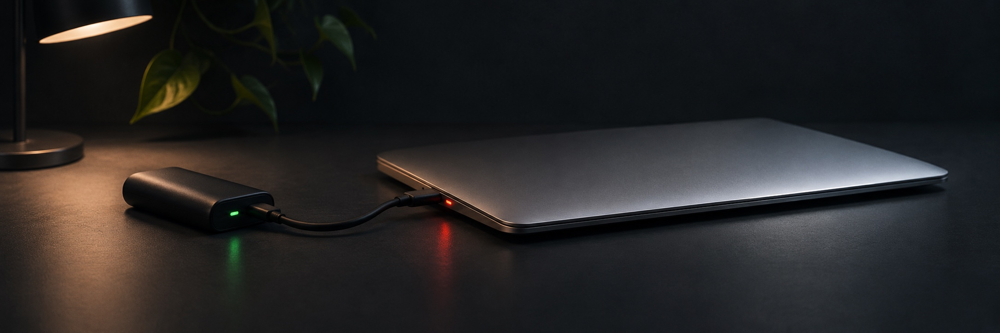

# dors-pas

> *Dors pas* is French for “don’t sleep.”



I wanted two switches on my MacBook. One keeps it awake, even with the lid closed. The other pauses charging so a power bank can run the Mac without spending its charge filling the internal battery.

So I put both in a Python script.

## Run it

From the repo directory, in an interactive terminal:

```sh
sudo python3 dors_pas.py
```

You’ll need Python 3.9 or later. The script uses only the standard library. It needs `sudo` to change sleep and charging settings. I tested it on an **M5 MacBook Air running macOS 26.5.2**, firmware `18000.121.3`. Charging control is firmware-dependent.

| Key | Action |
| --- | --- |
| **→** | Keep the Mac awake |
| **←** | Restore normal sleep |
| **↑** | Pause charging |
| **↓** | Release the charging pause |
| **Ctrl-C** | Quit and release both modes |

The charging pause requires external power and at least 10% battery. Unplugging or dropping below 10% releases it. Plugging back in leaves it off. In iTerm2, `WAKE` and `HOLD` turn red when their respective modes are on.

## Reading the output

The script prints a row when something changes. `PLUGGED` means the Mac detects a power source. `FROM_PLUG` means that source is delivering power. `IDLE` means the internal battery is neither charging nor discharging.

The power-bank case I wanted looks like this:

```text
PLUGGED | FROM_PLUG | IDLE | 73%
```

On my Mac, the bank kept it running at 73% for over 14 minutes with the pause on. After I released it, charging resumed. macOS took close to a minute to report some of those transitions. [Experiment notes](charging-experiments.md)
